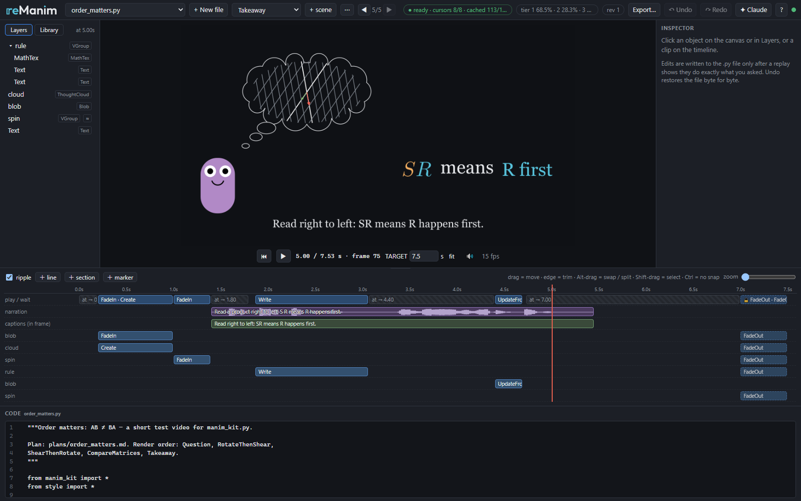

<h1><picture><source media="(prefers-color-scheme: dark)" srcset="studio/docs/img/wordmark-dark.svg"></picture></h1>

**A motion editor for [Manim Community Edition](https://www.manim.community/)
scenes, where the `.py` file stays the source of truth.** You see the
real Manim frame and a timeline of every `play()` and `wait()`. Drag,
retime, recolour or add things, and each change is written back into
your code as a small, readable edit, checked by re-running the scene
before anything is saved.



This repository holds reManim (in [`studio/`](studio/)) and the Manim
workspace it was built in: a few explainer videos, a toolkit for
narrated scenes, and the check tools used to make them. Most of it was
written with [Claude Code](https://claude.com/claude-code), following the
working rules in [`CLAUDE.md`](CLAUDE.md).

> **Status:** a personal project. It runs on **Windows** only for now
> (paths, the video tools and the launcher assume it). Expect rough
> edges, and expect things to change.

## What's here

| Path | What it is |
|---|---|
| [`studio/`](studio/) | **reManim**, the editor: a Python server (aiohttp) and a React UI. [Its README](studio/README.md) covers use; [`PLAN.md`](studio/PLAN.md) covers the design |
| `*.py` in this folder | The videos: `pythagoras.py`, `order_matters.py`, `gradient_descent.py`, `euler_identity.py`, `odd_squares.py`, `eola_preview.py` (a recreation study), `test_scene.py` (install smoke test) |
| `manim_kit.py` | Reusable parts: an absolute timeline with non-blocking narration and captions, a "Blob" character, speech bubbles, clipped grids for linear maps |
| `style.py` | Shared palette, text sizes and screen regions |
| `edge_tts_service.py` | Narration through Microsoft Edge's online neural voices, for [manim-voiceover](https://github.com/ManimCommunity/manim-voiceover) |
| `preview_server.py` | A live preview that re-renders on save, with a timeline linked to the code |
| `tools/` | A static layout check, contact sheets of frames, a narration check, joining scenes into one video, side-by-side comparison |
| `plans/` | One plan per video: goal, maths, beats, narration, colours |
| `docs/`, `reports/`, `research_notes/` | What we learned, and surveys of Manim tools |

## Requirements

- Windows 10 or 11
- [Python 3.13](https://www.python.org/downloads/)
- LaTeX: [MiKTeX](https://miktex.org/) (or TeX Live), for `MathTex` and
  `Tex`. `Text` works without it
- [Node.js 24](https://nodejs.org/) and npm, to build reManim's UI
- Optional: [Claude Code](https://claude.com/claude-code), for reManim's
  ✦ Claude panel; [Tailscale](https://tailscale.com/), to open reManim
  from your other devices

No separate FFmpeg is needed: Manim's PyAV does the encoding.

## Setup

In PowerShell:

```powershell
git clone https://github.com/Almer113/remanim.git
cd remanim
py -3.13 -m venv .venv
.venv\Scripts\python -m pip install -r requirements.txt
```

Build reManim's UI (use `npm.cmd`, since PowerShell's script policy may
block `npm`):

```powershell
cd studio\web
npm.cmd install
npm.cmd run build
cd ..\..
```

Check that Manim and LaTeX work:

```powershell
.venv\Scripts\python -m manim -ql -s test_scene.py
```

## Use

**reManim:** start the server from the repository folder, then open
<http://127.0.0.1:8770>.

```powershell
.venv\Scripts\python -m studio.server
```

Or double-click `studio\reManim.cmd` to open it in its own window. The
[studio README](studio/README.md) covers the screen, editing, export, the
keyboard and running it in the background.

**The videos:** render with plain Manim, for example:

```powershell
.venv\Scripts\python -m manim -ql order_matters.py
```

The output goes to `media/videos/<file>/<quality>/`.

**Narration:** the narrated videos use Edge TTS (voice
`en-US-AndrewNeural`). It needs no key, but the narration text is sent
to Microsoft's online speech service. Audio is cached in
`media/voiceovers/`, so only new or changed lines are sent.

**Tests:**

```powershell
.venv\Scripts\python -m studio.tests --quick
```

`--quick` runs the unit tests (about a minute, no LaTeX). With no flag it
also runs the engine tests (about 10 minutes, needs LaTeX).

## Updating

```powershell
git pull
.venv\Scripts\python -m pip install -r requirements.txt
cd studio\web
npm.cmd install
npm.cmd run build
cd ..\..
```

Then restart reManim if it's running.

## Licence

[MIT](LICENSE), except two files: `eola_common.py` and `eola_preview.py`
are adapted from [3Blue1Brown's scene code](https://github.com/3b1b/videos)
and stay under CC BY-NC-SA 4.0 (non-commercial). The Manim gallery
scenes in reManim's test corpus are MIT, from the Manim Community. The
details are in [`NOTICE.md`](NOTICE.md).

reManim is an independent project. It is not affiliated with or endorsed
by the Manim Community or 3Blue1Brown.
