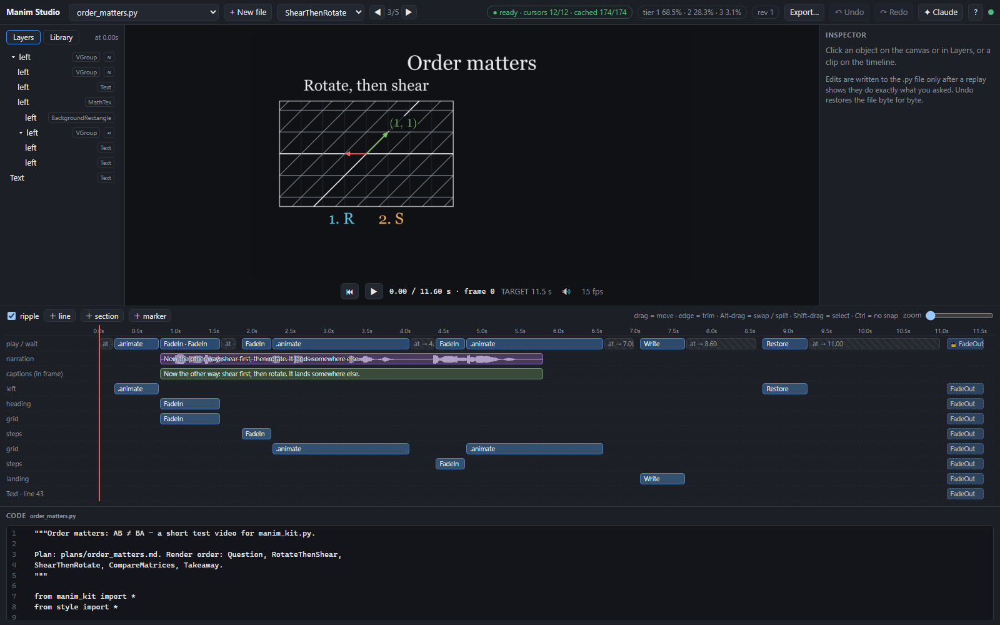

# Manim Studio

A motion editor for [Manim Community Edition](https://www.manim.community/)
scenes. You see the real Manim frame and a timeline of every `play()` and
`wait()`. You drag, retime, recolour and add things, and every change is
written straight into the `.py` file as a small, readable edit. The file
stays the only source of truth: edit it in your editor, or let Claude Code
edit it, and the studio picks the change up; edit in the studio, and the
code reads as if you had typed it.



"Manim Studio" is a working title. The design, its decisions and the
phases are in [PLAN.md](PLAN.md).

## Starting it

You need:
- the project's Python environment (`.venv`, Python 3.13, see
  `requirements.txt` in the project root);
- LaTeX (MiKTeX or TeX Live) for `MathTex` and `Tex`. `Text` works
  without it;
- Node 24 and npm, once, to build the web UI.

Build the UI once, and again after changing anything in `studio/web/src`:

```bash
cd studio/web && npm install && npm run build
```

Start the server from the project root:

```bash
.venv/Scripts/python -m studio.server
```

Open <http://127.0.0.1:8770>. In the Claude desktop app, the launch
configuration `manim-studio` does the same in the browser pane.

To use it like an app, in its own window without tabs or an address bar,
double-click `studio/Manim Studio.cmd` (or add `--app`). It opens Edge or
Chrome in app mode; nothing is installed. Close the console window to
stop the studio. If the studio is already running, the shortcut only
opens another window onto it. Pin the window to the taskbar if you like.

The server checks the built UI on start-up. If it's missing or older
than `web/src`, it tells you to build. If the port is taken (usually
because the studio is already running), it says so and stops.

| Option | What it does |
|---|---|
| `--port 8771` | Another port |
| `--allow-host NAME` | Also answer to `NAME`, for example a `tailscale serve` name, to use the studio from another device. The server still listens on 127.0.0.1 only. It prints a link with a token; other machines must open that link once, and the plain address is refused. Never point `tailscale funnel` at it: it runs your scene files. |
| `--app` | Open the studio in its own window (Edge or Chrome app mode) |
| `--allow-claude-remote` | Let pages opened through an `--allow-host` name use the Claude panel. Off by default, because the panel runs Claude Code on this machine |
| `--dev` | Let the Vite dev server (`npm run dev`, port 5173) talk to the studio, while working on the UI |

## The screen

| Area | What's there |
|---|---|
| **Header** | The file and scene, the engine's state, Export, Undo and Redo, ✦ Claude, and `?` for the shortcuts |
| **Layers** / **Library** (left) | What's on screen at the playhead, as a tree. The Library holds shapes, entrances, animation presets and composite presets (axes with a curve, a brace with a label, a title card …), placed by drag and drop |
| **Canvas** (middle) | The real frame. Click to select, drag to move, the handles scale and rotate. Double-click text to edit it in place. With a 2D or 3D camera, a camera mode moves the frame |
| **Inspector** (right) | The selection's properties: position, scale, colour from the palette, constructor arguments, axes ranges, curve formulas, a transform's kind, easing |
| **Timeline** (bottom) | Clips, one per `play()` and `wait()`. Drag an edge to retime and a body to move. Also: narration lines, captions, sounds, sections and markers |
| **Code peek** (bottom) | The lines behind the selection. Click a highlighted number or string to change it in place |

## What you can edit, and why some things are locked

Every edit becomes the smallest change to the code that does it. The
studio runs the changed file once before writing, to check the result
is what you asked for (the replay). If the replay disagrees, nothing is
written and you're told why.

How much you can edit depends on how the code is written:

- **Plain code** (`c = Circle(radius=1)`, `self.play(Create(c), run_time=2)`)
  is fully editable.
- **Computed code** (loops, helper functions, values worked out from
  others) can be selected, inspected and retimed. An edit changes the
  number the value comes from, or adds an "only this one" line after it.
  When one edit would change every pass of a loop or every use of a
  helper, the studio shows the diff and asks first.
- **Dynamic code** (updaters, `always_redraw`, custom animation classes)
  plays and is timed, but is locked 🔒: a click takes you to its line.

The tier of each statement shows in the Inspector, and the header shows
the share for the file.

## Working beside your editor or Claude Code

- The file is the state. Save in your editor, and the studio reloads by
  itself, keeping the selection and the playhead.
- If an import of the scene (`style.py`, `manim_kit.py`, …) changes, the
  studio restarts that file's engine and traces it again.
- Undo and Redo cover the studio's own edits, byte for byte. They refuse
  when the file has changed since, rather than overwrite your change.
  The history isn't kept when the server stops; git is the long-term
  history.
- If the file stops running (a typo while you type in your editor), the
  studio keeps showing the last version that ran, read-only, with the
  error and its line under the canvas.

## Asking Claude

✦ Claude opens a panel where you can ask Claude Code about the open
file, or ask for a change ("make the circle blue and slower", "why does
the label jump at 3 s?"). It runs your own Claude Code (`claude -p`) in
the project folder, so `CLAUDE.md` and your Claude Code settings apply,
and the question goes with a note of where you are: the file, scene,
playhead and selection.

- Claude can read, search and edit files, but has no shell, so it can't
  render. It edits the `.py` file directly and the studio reloads it, as
  with any save.
- The studio's Undo doesn't cover Claude's edits; git does.
- A follow-up continues the same conversation until **New chat**. One
  question runs at a time; **Stop** ends it. Each answer shows its time
  and cost. Even a short answer costs something, because Claude Code
  reads the project's instructions each time.
- It needs Claude Code installed and signed in (`claude` on PATH, or the
  native installer's `~/.local/bin`).
- Pages opened from another machine (`--allow-host`) don't get the panel
  unless the server was started with `--allow-claude-remote`.

## Export

Export… (or `Ctrl+E`) renders real video with plain `manim`, exactly as
on the command line. You choose:
- the scenes (all, this one, or a pick);
- the quality (480p15 up to 4K);
- the format (MP4, WebM, GIF, MOV, PNG frames; transparent backgrounds
  for MOV, WebM and PNG).

Two more options:
- join the scenes into one video, with the narration rebuilt as one
  audio track (`media/<file>_full_<quality>.mp4`);
- check that the narration is really in the files.

Scenes render one at a time with progress. A scene that fails stops the
export before anything is joined. Exports keep running when the dialog
closes, and the finished files play in the dialog. While the studio
renders a file, the preview server waits for it, and the other way
round, because two renders of one file at once break each other on
Windows.

Draft at low quality first. The dialog warns before a high-quality
render of scenes you haven't seen at low quality.

## Keyboard

Shortcuts are off while a text field has focus or an overlay is open (the
glyph picker, the text editor, camera mode, a dialog). Those have their
own keys, and `Esc` closes them.

<!-- keys:begin (generated from web/src/keymap.ts by `node web/checks/keymap_md.ts`) -->
| Keys | What it does |
|---|---|
| **Playback** | |
| `Space` `K` | Play / pause |
| `←` `,` | One frame back (← when nothing is selected) |
| `→` `.` | One frame on (→ when nothing is selected) |
| `J` `Shift+←` | One second back |
| `L` `Shift+→` | One second on |
| `Home` | Start of the scene |
| `End` | End of the scene |
| `[` | Previous clip start |
| `]` | Next clip start |
| **Objects** | |
| `←` | Nudge the selection left (Shift ×10, Alt fine) |
| `→` | Nudge right |
| `↑` | Nudge up |
| `↓` | Nudge down |
| `Ctrl+D` | Duplicate |
| `Ctrl+G` | Group the selection (Shift-click adds objects) |
| `Delete` `Backspace` | Delete the selection |
| `Esc` | Clear the selection |
| **Edit** | |
| `Ctrl+Z` | Undo |
| `Ctrl+Shift+Z` `Ctrl+Y` | Redo |
| **Timeline** | |
| `R` | Ripple on / off |
| `M` | Marker at the playhead |
| **App** | |
| `Ctrl+E` | Export video |
| `?` | Show the keyboard shortcuts |
<!-- keys:end -->

Arrow-key nudges add up while you hold the key, and are written as one
move (one undo step) when you stop.

## When something goes wrong

| You see | It means | Do |
|---|---|---|
| "The file doesn't run at line N" | A syntax error or a crash while the file loads | Fix it and save. Meanwhile the last version that ran stays on screen |
| "This scene stops with an error" | The scene crashes part-way | The clips before the error still play; fix and save |
| "tracing X… 20 s [Stop]" | A scene is taking long, perhaps an endless loop | Stop it. It's skipped until the file changes |
| "LaTeX isn't installed or isn't on PATH" | `MathTex`/`Tex` can't compile | Install MiKTeX or TeX Live, or use `Text` |
| "The file is gone" | It was deleted or renamed outside the studio | Put it back; the studio picks it up |
| "the file is read-only" | Exactly that | Make it writable |
| "the file changed; try again" | It was saved elsewhere while you edited | Do the edit again |
| A red dot in the header | The server isn't reachable | Start it; the page reconnects by itself |

The full list, with what still works in each case: [docs/phase6/errors.md](docs/phase6/errors.md).

## For developers

| Path | What it is |
|---|---|
| `server/` | Python backend. `app.py` (HTTP and WebSocket), `project.py` (one open file: edits, undo, traces), `code/` (parsing and planning edits), `engine/` (the Manim worker process), `export.py`, `tracecache.py` |
| `web/` | The UI: React and TypeScript, built with Vite |
| `tests/` | `unit/`, `engine/` (through a real worker), the corpus, and the benches |
| `docs/` | Architecture, protocol, code specification, one folder per phase |

Run the checks:

```bash
.venv/Scripts/python -m studio.tests --quick
```

`--quick` runs the unit tests (seconds, no LaTeX). With no flag it
also runs the engine tests (about 8 minutes). `--all` adds the corpus run
and the benches (about 1.5 hours). Don't run them while the studio
server is busy: they share `media/Tex_studio`.
